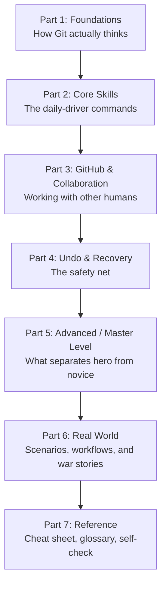

# Git & GitHub: Zero to Hero

Welcome. This is a complete, self-contained course that takes you from *"I don't know anything about GitHub"* to genuinely understanding this stuff more deeply than most people who've used it for 20 years.

That's not a hype line. Here's the actual reason it's true: **most developers never learn how Git works — they learn a dozen commands that fixed whatever was broken that day, by copy-pasting from Stack Overflow, and they never touch the ones they haven't needed yet.** That's why you'll see senior engineers with a decade of experience freeze up the moment a merge conflict looks slightly unfamiliar, or force-push and accidentally erase a teammate's work, or not know that `git reflog` exists (it's the single most underused "undo everything" command in the tool).

This course does it differently. You're going to learn the **model** underneath Git first — how it actually stores your work on disk — and once that clicks, every command stops being a magic spell you memorize and becomes something you can *derive*. When you hit a situation nobody wrote a tutorial for, you'll be able to reason your way out instead of panicking.

> [!TIP]
> If you only remember one sentence from this entire course, make it this: **Git doesn't store changes. Git stores snapshots.** Almost every beginner misconception traces back to not knowing this. Chapter 1 explains it properly.

---

## Who this is for

Someone who has never opened a terminal for version control before, but is willing to actually read (not just skim for commands). Every chapter assumes only the previous chapters. By the end, you'll be comfortable with the things that make experienced engineers nervous: rewriting history, recovering from a bad force-push, resolving gnarly conflicts, bisecting a regression across 300 commits, and designing a branching strategy for a team.

## How to use this course

1. **Go in order the first time.** Chapters build on each other deliberately — especially Chapters 1–8, which form the spine of everything else.
2. **Actually type the commands.** Create a throwaway folder and a scratch Git repo (`git init playground`) and run every example as you read it. Reading about `git rebase -i` and running it are completely different experiences.
3. **Come back to it as a reference.** Every chapter is also written to be looked up later — there's a full cheat sheet and glossary at the end (Chapter 21).
4. **Don't be afraid to break your playground repo.** That's what it's for. Chapter 18 (Disaster Recovery) exists precisely so you learn that almost nothing in Git is truly unrecoverable once you understand `reflog`.

## The learning path

## Full table of contents

### Part 1 — Foundations
| Chapter | Title | What you'll walk away with |
|---|---|---|
| 1 | [Git Mental Model & Internals](01-git-mental-model-and-internals.md) | Why Git exists, and what actually happens on disk when you commit |
| 2 | [Installation & Configuration](02-installation-and-setup.md) | Git and GitHub set up properly, with SSH keys and sane defaults |

### Part 2 — Core Skills
| Chapter | Title | What you'll walk away with |
|---|---|---|
| 3 | [Core Workflow Basics](03-core-workflow-basics.md) | `add`, `commit`, `status`, `diff`, `log`, `.gitignore` — used correctly, not just memorized |
| 4 | [Branching Deep Dive](04-branching-deep-dive.md) | What a branch *actually is*, and total comfort creating/switching/deleting them |
| 5 | [Merging Explained](05-merging-explained.md) | Fast-forward vs. three-way merges, and what a merge commit really contains |
| 6 | [Merge Conflicts Mastery](06-merge-conflicts-mastery.md) | Every type of conflict, and a calm, repeatable process to resolve any of them |
| 7 | [Rebase Mastery](07-rebase-mastery.md) | Interactive rebase, squashing, and the Golden Rule that keeps you out of trouble |
| 8 | [Remotes & Collaboration](08-remotes-and-collaboration.md) | `fetch` vs `pull` vs `push`, upstream tracking, and fork workflows |

### Part 3 — GitHub & Collaboration
| Chapter | Title | What you'll walk away with |
|---|---|---|
| 9 | [GitHub Platform Essentials](09-github-platform-essentials.md) | Repos, issues, forks, and the GitHub CLI |
| 10 | [Pull Requests & Code Review](10-pull-requests-and-code-review-workflow.md) | Running a full PR lifecycle like a professional team does |

### Part 4 — Undo & Recovery
| Chapter | Title | What you'll walk away with |
|---|---|---|
| 11 | [Undoing Changes & Time Travel](11-undoing-changes-time-travel.md) | `restore`, `reset`, `revert`, and `reflog` — the real differences, finally |
| 12 | [Stash, Cherry-pick & Bisect](12-stash-cherrypick-bisect.md) | Context-switching, porting fixes, and hunting bugs with binary search |

### Part 5 — Advanced / Master Level
| Chapter | Title | What you'll walk away with |
|---|---|---|
| 13 | [Tags, Releases & Versioning](13-tags-releases-versioning.md) | Real releases, semantic versioning, and annotated vs lightweight tags |
| 14 | [Advanced Git Toolkit](14-advanced-git-toolkit.md) | Hooks, submodules, worktrees, LFS, and signed commits |
| 15 | [Rewriting History Safely](15-rewriting-history-safely.md) | Cleaning history, purging secrets, and force-pushing without destroying your team |
| 16 | [Branching Strategies & Workflows](16-branching-strategies-and-workflows.md) | Git Flow vs GitHub Flow vs Trunk-Based Development — and which to pick |
| 17 | [GitHub Actions & Automation](17-github-actions-and-automation.md) | Reading and writing your first CI/CD pipelines |

### Part 6 — Real World
| Chapter | Title | What you'll walk away with |
|---|---|---|
| 18 | [Disaster Recovery Playbook](18-disaster-recovery-playbook.md) | A "break glass in case of emergency" cookbook for 20 real disasters |
| 19 | [Real-World Scenario Simulator](19-real-world-scenario-simulator.md) | A full week-in-the-life story showing everything working together |
| 20 | [Best Practices & Etiquette](20-best-practices-and-etiquette.md) | How professional teams actually write commits and run reviews |

### Part 7 — Reference
| Chapter | Title | What you'll walk away with |
|---|---|---|
| 21 | [Cheat Sheet, Glossary & Mastery Checklist](21-cheat-sheet-glossary-and-mastery-checklist.md) | Everything on one page, plus a self-test to prove you've made it |

---

## A note on philosophy before you start

Git has a reputation for being confusing. It isn't, really — it's just that almost every tutorial teaches commands as if they were arbitrary incantations ("run this to save your work, run that to sync it") instead of teaching the very simple data structure underneath (a graph of snapshots) that makes all the commands fall out naturally. You're about to get the second kind of tutorial.

One more thing: **you cannot break Git as badly as you think you can.** Every commit you ever make sticks around (even "deleted" ones) for months by default, recoverable via `reflog`, until Git's garbage collector eventually cleans up genuinely unreachable objects. Keep that in your back pocket as you experiment — it's the reason experienced engineers stay calm when something looks broken.

Turn to [Chapter 1](01-git-mental-model-and-internals.md) when you're ready.
