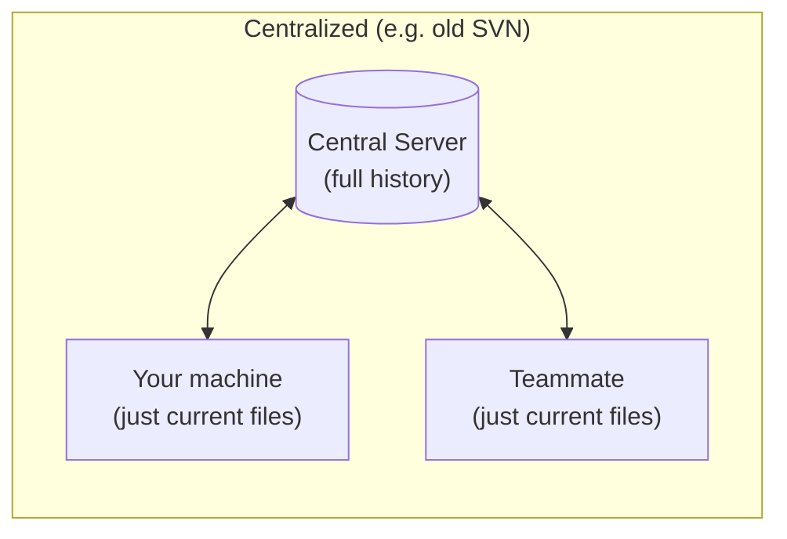
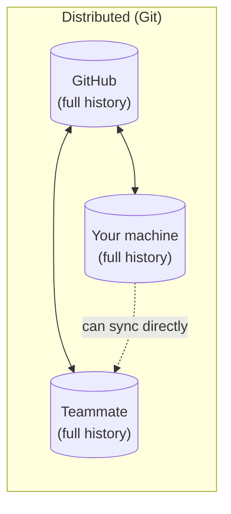
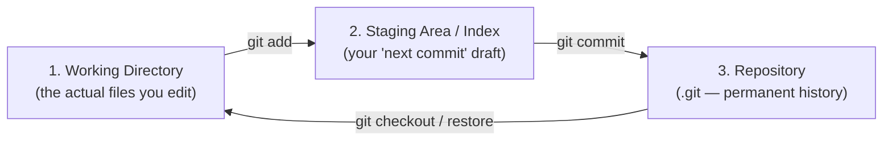
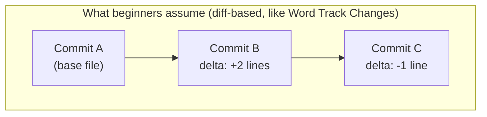
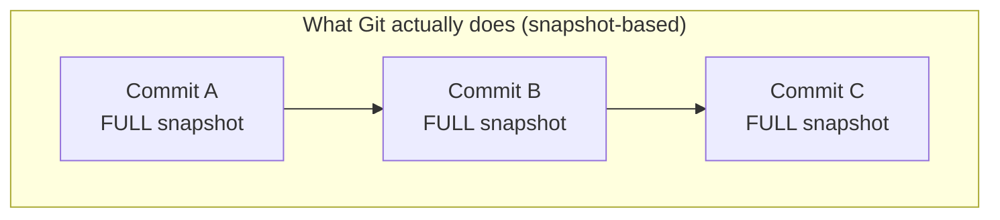
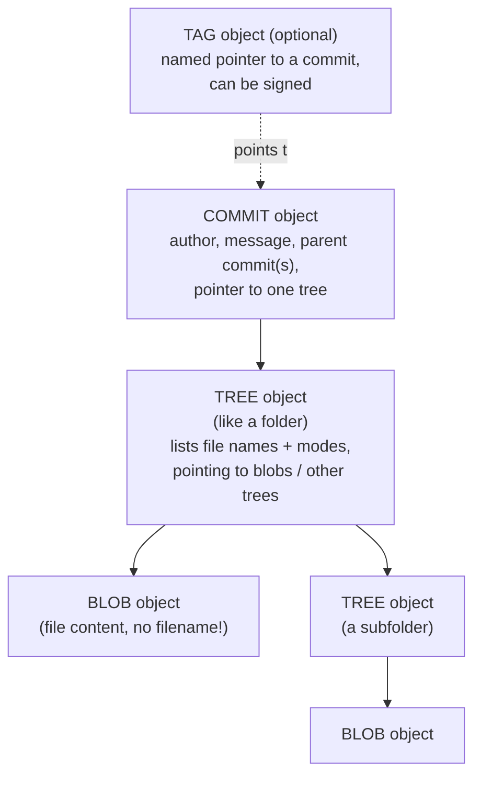
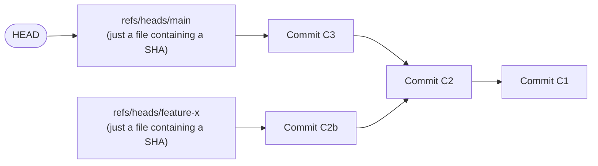
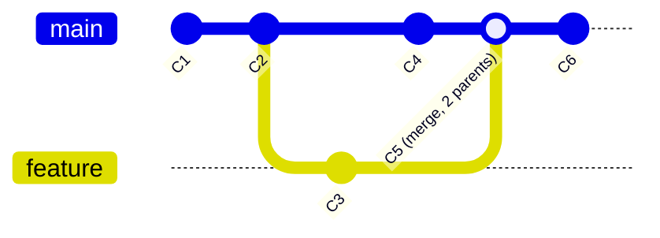

# Chapter 1 — Git Mental Model & Internals

> Read this chapter slowly. Everything else in this course is easy once this one actually sinks in.

## 1.1 The problem Git solves

Imagine you're writing a document with three friends, over email, with no version control. You've all lived some version of this:

```
proposal.docx
proposal_v2.docx
proposal_v2_FINAL.docx
proposal_v2_FINAL_johns_edits.docx
proposal_v2_FINAL_johns_edits_ACTUALLYFINAL.docx
proposal_v2_FINAL_johns_edits_ACTUALLYFINAL_useThisOne(2).docx
```

Nobody knows which file is current. Nobody can tell what changed between versions without opening both and squinting. If two people edit at once, someone's work gets silently overwritten when they email their copy back. There's no way to ask "what did this file look like last Tuesday" or "who wrote this specific sentence."

**Version control systems exist to solve exactly this problem** — for code, but the same problem exists for any collaborative work. Git is, at its heart, nothing more than an extremely well-engineered way to answer three questions at any point in time:

1. What did every file look like at this moment?
2. What changed between this moment and the last one?
3. Can I get back to any previous moment, instantly, without losing anything?

## 1.2 A little history (so this doesn't feel arbitrary)

Git was written in 2005 by **Linus Torvalds** — the creator of Linux — in about 10 days. The backstory matters, because it explains *why* Git is shaped the way it is:

The Linux kernel project (thousands of contributors, one of the largest codebases on Earth) was using a proprietary tool called BitKeeper. In 2005, the company behind BitKeeper revoked free access after a dispute. Linus needed a replacement, fast, that could handle:

- Thousands of contributors working in parallel
- No single central server being a hard requirement
- Extreme speed even on a codebase with hundreds of thousands of files
- Absolute trust that history couldn't be silently corrupted

That last point is why every single piece of content in Git is checksummed with a cryptographic hash — you'll see this in a moment, and it's not an implementation detail, it's the core design. Git was built by someone who needed to trust history absolutely, at scale, without a central authority. Every design decision — snapshots instead of diffs, content-addressable storage, cheap branching — traces back to those requirements.

**GitHub**, by contrast, is not Git. GitHub is a company (founded 2008, bought by Microsoft in 2018) that built a website *around* Git — adding hosting, a social layer (stars, followers), a code-review workflow (Pull Requests), issue tracking, and automation (Actions). You could use Git for your entire career and never touch GitHub. GitLab, Bitbucket, and Gitea are competitors that do roughly the same thing. **Git is the engine. GitHub is one of several cars built around it.** Keep this distinction in your head — it clears up a huge amount of beginner confusion about "is this a Git thing or a GitHub thing?" (You'll see that label called out throughout this course.)

## 1.3 Centralized vs. Distributed: why Git branches are "free"

Older systems like SVN or CVS are **centralized**: there's one server with The History, and your computer just has the current files plus a thin record of what you've checked out. Every meaningful operation (viewing history, committing, branching) needs to talk to the server.

Git is **distributed**: when you clone a repository, you download the *entire history* — every commit, every branch, every tag, ever made (that's been pushed). Your laptop has just as complete a copy as GitHub's servers do.





This is *why* branching in Git is instant and cheap (it's a local operation on data you already have), why you can commit on an airplane with no internet, and why there's no single point of failure — if GitHub disappeared tomorrow, every contributor's laptop would still have the complete project history.

## 1.4 The three trees: Working Directory, Staging Area, Repository

This is the single most important practical mental model in Git. Every command you'll ever run moves content between exactly these three places:



| Area | What it is | Real-life analogy |
|---|---|---|
| **Working Directory** | The actual files on your disk that you open, edit, and see in your editor. | The papers spread out on your physical desk right now. |
| **Staging Area (a.k.a. "the index")** | A holding area where you build up *exactly* what will go into your next commit — you can add some changed files but not others. | A shopping cart. You wander the store (working directory) picking things up, but nothing is "bought" (committed) until you check out. |
| **Repository (`.git` folder)** | The permanent, immutable history of every commit ever made. | A shelf of sealed, dated photo albums — once a photo is in an album, that exact photo never changes. |

The staging area is the concept beginners find most alien coming from tools like Google Docs (which just auto-saves everything). It exists because **it lets you craft precise, intentional commits** instead of "save literally every change I made in the last hour, good and bad, mixed together." You'll use `git add -p` in Chapter 3 to stage *parts* of a file — that's only possible because staging is a separate step from both editing and committing.

> [!NOTE]
> "The index" and "the staging area" are the exact same thing — you'll see both terms used interchangeably in Git's own documentation and error messages. Don't let that trip you up.

## 1.5 The single most important correction to your mental model

**Beginners assume Git stores a list of changes (diffs) between versions, like "track changes" in Word.** This is wrong, and it's wrong in a way that will confuse you constantly until you unlearn it.

**Git stores complete snapshots.** Every time you commit, Git looks at every file in your project and, conceptually, takes a full photograph of the entire tree. If a file didn't change since the last commit, Git doesn't re-copy it — it just points the new snapshot at the exact same stored file it already has (more on how in a moment). But conceptually, every commit is a complete, standalone, full copy of your entire project at that instant.





Git *computes* diffs on the fly when you ask for them (`git diff`, `git log -p`) by comparing two snapshots — but it never stores a diff as the source of truth. This is precisely why operations like checking out an old commit, or jumping between distant branches, are equally fast whether the commit is 2 versions old or 20,000: Git just swaps in the snapshot, it never "replays" a chain of patches.

## 1.6 What's actually inside `.git` — the four object types

Every Git repository is, underneath everything, a **content-addressable key-value store**: a big pile of objects, each one identified by the SHA hash of its own content. There are exactly four kinds of objects. Understanding these four is what separates "I use Git" from "I understand Git."



| Object | Contains | Key insight |
|---|---|---|
| **Blob** | The raw content of a single file — just bytes, nothing else | A blob has **no filename and no metadata**. Two files with identical content anywhere in your project (even in different folders, even in different commits) are the *exact same blob*, stored once. |
| **Tree** | A list of entries: names, file permissions, and pointers to blobs (for files) or other trees (for subfolders) | This is what gives files their names and directory structure — that information lives in the tree, not the blob. |
| **Commit** | A pointer to one tree (the project's root at that moment), pointer(s) to parent commit(s), author, committer, timestamp, and a message | A commit is a snapshot **plus context**: who, when, why, and what came before. |
| **Tag (annotated)** | A pointer to a commit, plus a message and optionally a cryptographic signature | Used for marking release points — see Chapter 13. |

### See it with your own eyes

This isn't theoretical — you can inspect these objects directly. Try this in any Git repo:

```bash
$ echo "hello world" > greeting.txt
$ git hash-object greeting.txt
3b18e512dba79e4c8300dd08aeb37f8e728b8dad
```

That long string is the **SHA-1 hash of the content "hello world\n"**. Notice: it was computed *before you even ran `git add`*. Git hashed the content itself — this exact hash will be identical on every computer on Earth for that exact content. That's what "content-addressable" means: the "address" (the hash/ID) of an object *is* a fingerprint of its content. Change one byte, and you get a completely different hash.

After committing, you can look inside the actual object database:

```bash
$ git add greeting.txt && git commit -m "add greeting"
$ git cat-file -p HEAD
tree 8f4e04f4a2b1c3d4e5f6...
author Your Name <you@example.com> 1699999999 +0000
committer Your Name <you@example.com> 1699999999 +0000

add greeting

$ git cat-file -p HEAD^{tree}
100644 blob 3b18e512dba79e4c8300dd08aeb37f8e728b8dad    greeting.txt

$ git cat-file -p 3b18e512dba79e4c8300dd08aeb37f8e728b8dad
hello world
```

Look at that chain: **commit → tree → blob**, exactly as the diagram showed. `git cat-file -p` ("pretty-print") is a **plumbing command** — a low-level tool most tutorials never mention, that lets you look directly at Git's internal database. `git log`, `git status`, `git commit` etc. are **porcelain commands** — the user-friendly layer built on top of plumbing. Knowing plumbing exists (and being able to poke at it when curious or debugging) is a genuine hero-level habit.

> [!TIP]
> This is why Git can tell you a file is "unchanged" instantly even in a repo with 500,000 files: it just compares the tree's stored hash for that file against a freshly computed hash. If they match, byte-for-byte identity is *mathematically guaranteed* (a SHA-1 or SHA-256 collision is astronomically unlikely) — no need to actually diff the content.

## 1.7 SHA hashes: why that ugly 40-character string matters

Every object's ID (`3b18e512dba7...`) is a hash of its own content, computed with SHA-1 (older/current default) or SHA-256 (newer repos can opt in). Three consequences fall directly out of this, and all three are things a novice never connects together:

1. **Identical content is only ever stored once.** If you copy-paste the same 200-line function into ten files, Git stores that content as *one* blob, referenced ten times. This is why Git repos are far more space-efficient than "just zip up every version" would be.
2. **You cannot silently tamper with history.** If someone edited an old commit's content directly on disk, its hash would change — and every commit after it (which references it, directly or indirectly) would need a different hash too, cascading forward. This is the same principle blockchains later borrowed. It's why `git log` output can be trusted: the commit ID *is* a checksum of everything before it.
3. **Two people on opposite sides of the planet, with no coordination, will compute the identical hash for identical content.** This is what lets Git merge histories from totally disconnected clones without a central naming authority.

## 1.8 Branches and HEAD: the two ideas that unlock everything

Here is the fact that, more than anything else, will make Git branching finally make sense:

> **A branch is nothing but a small text file containing one 40-character commit hash.** That's it. That's the whole thing.

Look inside `.git/refs/heads/` in any repo and you'll find literal files — `main`, `feature-login`, whatever — each containing nothing but a single commit SHA. "Creating a branch" is Git writing one new small file. "Switching branches" is Git changing which file `HEAD` points to and updating your working directory to match that commit's tree. There is no per-branch copy of your entire project sitting around somewhere — that's why branching is instant even in a repository with a 10-year history.



**HEAD** is one level of indirection on top of that: it's a pointer to *the branch you currently have checked out* (which itself points to a commit). Normally HEAD points at a branch name, which points at a commit — "HEAD → main → commit C3." When you run `git checkout main`, Git is just rewriting the tiny file `.git/HEAD` to say `ref: refs/heads/main`.

This is also why **"detached HEAD"** (a phrase that terrifies beginners) is simple once you see it this way: it just means HEAD is pointing *directly* at a commit hash instead of at a branch name. You're still perfectly safe, you just aren't "on" a named branch — covered fully in Chapter 4.

## 1.9 The commit graph is a DAG (and why that word matters)

Because every commit stores a pointer to its parent(s), the full history of a repository forms a **Directed Acyclic Graph (DAG)**: a graph where edges only point one way (a commit points *back* to its parent, never forward) and there are no cycles (you can never follow "parent" links and end up back where you started).

- A normal commit has **exactly one parent**.
- The very first commit in a repo has **zero parents**.
- A **merge commit** has **two (or more) parents** — this is the entire mechanism that lets two divergent lines of history "join back up." (Full detail in Chapter 5.)



Everything you do in Git — branching, merging, rebasing, cherry-picking, bisecting — is really just **operations on this graph of commits**: adding nodes, moving pointers, or re-parenting nodes. Once you can picture the graph in your head, commands like `git log --graph --oneline --all` (try it right now in any repo) stop being ASCII soup and start being a literal picture of the exact structure described above.

## 1.10 Recap: the mental model in one paragraph

A Git repository is a content-addressed database of four object types (blobs, trees, commits, tags), forming a DAG of snapshots. Branches are cheap, movable pointers (just a filename + a SHA) into that graph. HEAD tells you which branch (or commit) you're currently standing on. Your working directory and staging area are just two waypoints between "a file you're editing" and "a permanent, hashed, unchangeable snapshot in the graph." Every command in the rest of this course is just a different way of reading from, or adding nodes to, or moving pointers around in, this one graph.

Hold onto that. Next: [Chapter 2 — Installation & Configuration](02-installation-and-setup.md), where you'll get set up and start touching real commands.
