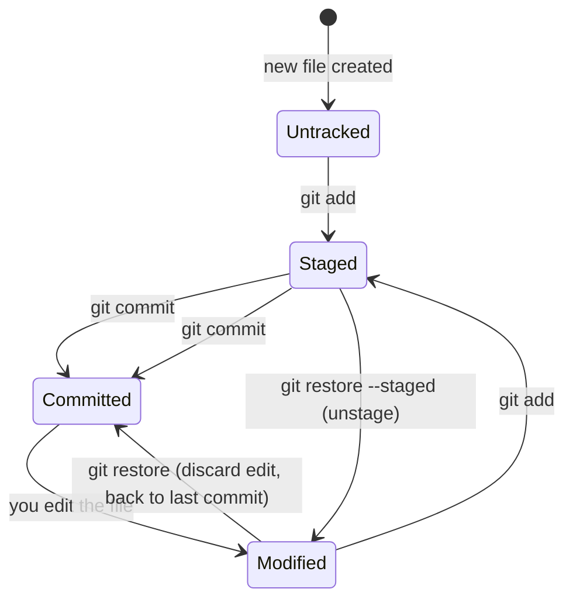

# Chapter 3 — Core Workflow Basics

Time to actually use Git. Everything here maps directly onto the three-trees model from [Chapter 1](01-git-mental-model-and-internals.md#14-the-three-trees-working-directory-staging-area-repository) — keep that diagram in mind as you go.

## 3.1 `git init` vs `git clone`

```bash
git init my-project      # Start a brand-new, empty repository
```
```bash
git clone git@github.com:user/repo.git   # Copy an existing repository (full history!) to your machine
```

`clone` doesn't just grab the current files — it downloads **every commit, branch, and tag** that's been pushed to that remote. You end up with a complete, independent copy of the project's entire history, per the distributed model from Chapter 1.

## 3.2 `git status` — your most-run command, read properly

```bash
$ git status
On branch main
Changes to be committed:
  (use "git restore --staged <file>..." to unstage)
        modified:   index.html

Changes not staged for commit:
  (use "git add <file>..." to update what will be committed)
  (use "git restore <file>..." to discard changes in working directory)
        modified:   style.css

Untracked files:
  (use "git add <file>..." to include in what will be committed)
        notes.txt
```

Three sections, three states, mapped directly onto the three trees:

| Section | Meaning | Which tree it's in |
|---|---|---|
| **Changes to be committed** | Staged — will be included in your *next* `git commit` | Staging area |
| **Changes not staged for commit** | Modified since the last commit, but not staged | Working directory only |
| **Untracked files** | Git has never seen this file before; it's not part of history at all | Working directory only, invisible to Git's history |

Run `git status` constantly — before and after nearly every other command — until reading it becomes reflexive. It will never lie to you about what's about to happen.

## 3.3 `git add` — staging, precisely

```bash
git add index.html          # stage one specific file
git add src/ tests/         # stage everything under these folders
git add .                   # stage everything in and below the current directory
git add -A                  # stage everything in the ENTIRE repo, including deletions, regardless of cwd
```

### The hero-level move: `git add -p` (patch mode)

Most people stage entire files. Professionals frequently stage **parts** of a file — because "one commit = one logical change" is a core best practice (Chapter 20), and you often edit two unrelated things before committing either.

```bash
$ git add -p style.css
```
Git walks you through each contiguous chunk of changes ("hunks") one at a time and asks:
```
Stage this hunk [y,n,q,a,d,s,e,?]?
```
| Key | Action |
|---|---|
| `y` | Yes, stage this hunk |
| `n` | No, skip this hunk |
| `s` | Split this hunk into smaller ones (if possible) |
| `e` | Manually edit exactly which lines to stage |
| `q` | Quit, stop reviewing |

This lets you build a clean, focused commit even when your working directory currently has three different concerns tangled together in the same file.

## 3.4 `git commit` — sealing a snapshot

```bash
git commit -m "Add input validation to signup form"
```

Leave off `-m` and Git opens your configured editor for a full message — do this for anything beyond a trivial change (message conventions in [Chapter 20](20-best-practices-and-etiquette.md)).

```bash
git commit -am "Fix typo"    # shortcut: stage every ALREADY-TRACKED modified file, then commit
```
> [!WARNING]
> `-a` only picks up changes to files Git **already tracks**. It will silently skip brand-new untracked files — a very common source of "wait, why isn't my new file in this commit?"

A quick preview of a command you'll use constantly once you're comfortable: `git commit --amend` lets you fix the message or contents of the commit you *just* made, instead of creating a new one. Full treatment in [Chapter 11](11-undoing-changes-time-travel.md).

## 3.5 `git diff` — seeing exactly what changed

```bash
git diff                # working directory vs. staging area (unstaged changes)
git diff --staged       # staging area vs. last commit (what your NEXT commit will contain)
git diff --staged       # (alias: --cached — identical meaning)
git diff HEAD           # working directory vs. last commit (staged + unstaged combined)
git diff main feature   # compare two branches directly
git diff HEAD~3 HEAD    # compare current commit to 3 commits ago
```

Reading diff output:
```diff
diff --git a/app.js b/app.js
index e69de29..8f3a91c 100644
--- a/app.js
+++ b/app.js
@@ -12,6 +12,8 @@ function login(user) {
   if (!user) return false;
-  return checkPassword(user);
+  const valid = checkPassword(user);
+  logAttempt(user, valid);
+  return valid;
 }
```
`-` lines were removed, `+` lines were added, unmarked lines are unchanged context. The `@@ -12,6 +12,8 @@` header means "starting at line 12, 6 lines shown from the old version; starting at line 12, 8 lines shown in the new version" — it's just there to help you locate the change, not something you need to parse manually.

## 3.6 `git log` — mastering your history

```bash
git log                              # full detail, newest first
git log --oneline                    # one line per commit — for a quick scan
git log --oneline --graph --all      # a visual tree of every branch (you set this up as `git lg` in Ch. 2)
git log --stat                       # plus a summary of files changed per commit
git log -p                           # plus the FULL diff of every commit
git log -5                           # just the last 5 commits
git log --author="Priya"             # filter by author
git log --since="2 weeks ago"        # filter by date (accepts natural language!)
git log --grep="login"               # filter by commit message content
git log -- path/to/file.js           # history of ONE specific file only
git log --follow -- old-name.js      # ...even through a rename
```

Custom format for scripting or a cleaner view:
```bash
git log --pretty=format:"%h %an %ar %s"
# a1b2c3d Priya 3 days ago Add input validation
```

## 3.7 `.gitignore` — telling Git what to never track

Not every file belongs in version control: build output, dependency folders (`node_modules/`), secrets (`.env`), OS clutter (`.DS_Store`), editor settings. A `.gitignore` file (one per repo, at the root, plain text) lists patterns Git should simply never show you as "untracked."

```gitignore
# Dependencies
node_modules/
venv/

# Build output
dist/
build/
*.pyc

# Secrets — NEVER commit these
.env
.env.local
*.pem

# OS/editor noise
.DS_Store
.vscode/
*.swp
```

Pattern rules:
| Pattern | Matches |
|---|---|
| `*.log` | Any file ending in `.log`, anywhere |
| `build/` | A folder named `build`, anywhere (trailing slash = directory only) |
| `/config.json` | `config.json` only at the repo root (leading slash anchors it) |
| `!important.log` | **Negation** — un-ignore a file that an earlier pattern would have excluded |

Generate a good starting point for any language/framework at [github.com/github/gitignore](https://github.com/github/gitignore), or via `gh repo clone github/gitignore` locally, or through the "Add .gitignore" template picker when creating a repo on GitHub itself.

> [!CAUTION]
> **`.gitignore` only affects untracked files.** If a file is *already committed*, adding it to `.gitignore` does nothing — Git keeps tracking it. To fix that:
> ```bash
> git rm --cached .env      # stop tracking it, but keep the file on disk
> echo ".env" >> .gitignore
> git commit -m "Stop tracking .env"
> ```
> If that file contained a real secret, removing it going forward is not enough — see the "Committed a Secret" scenario in [Chapter 18](18-disaster-recovery-playbook.md) for how to purge it from history too, and why **rotating the credential** matters more than the cleanup.

There's also a **global gitignore**, for patterns you want ignored in *every* repo on your machine (e.g., your personal editor's junk files), regardless of whether the project's own `.gitignore` mentions them:
```bash
git config --global core.excludesFile ~/.gitignore_global
```

## 3.8 The full file lifecycle, in one picture



You now have the entire daily loop: edit → `status` → `add` (maybe `-p`) → `diff --staged` to double check → `commit` → `log` to confirm. Next: [Chapter 4 — Branching Deep Dive](04-branching-deep-dive.md).
