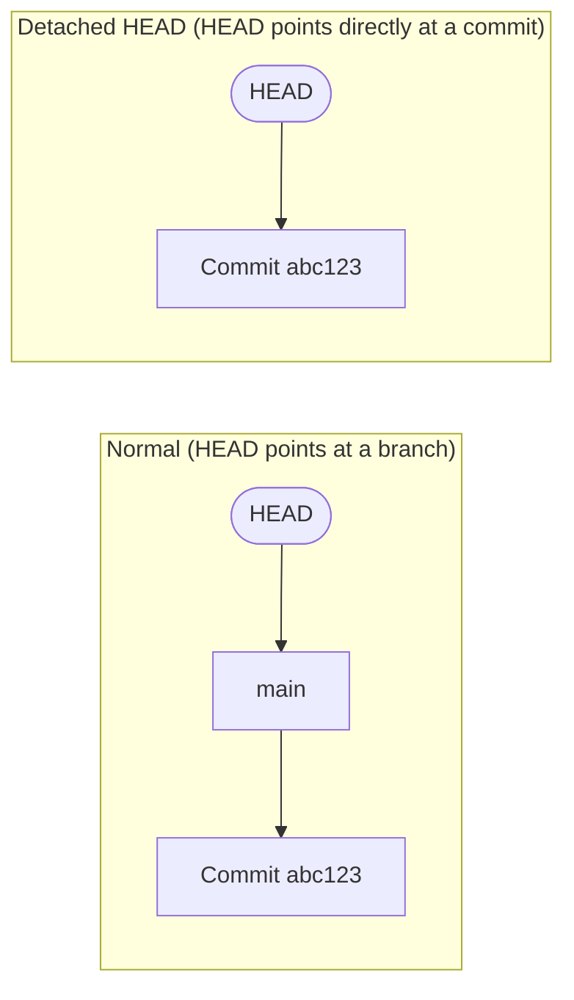

# Chapter 4 — Branching Deep Dive

## 4.1 What a branch actually is (recap + why it matters practically)

From [Chapter 1](01-git-mental-model-and-internals.md#18-branches-and-head-the-two-ideas-that-unlock-everything): a branch is a movable pointer to one commit — physically, a small file in `.git/refs/heads/` holding a single 40-character SHA. When you make a new commit while "on" a branch, Git does exactly one extra thing after creating the commit object: it updates that branch's file to point at the new commit's SHA instead.

This has a practical consequence worth stating explicitly: **branches cost nothing and create nothing except one small pointer file.** There is no copying of your project. This is why professional workflows push you to branch constantly and freely — a branch is not a heavyweight decision the way "forking the entire codebase into a new folder" would be.

**Real-life analogy:** think of your commit history as a single road. A branch lets you peel off onto a side road to try something — build a detour, a shortcut, an experiment — while the main road carries on completely undisturbed. You can merge your side road back into the highway later (Chapter 5), or abandon it entirely with zero consequence to the main road if the experiment didn't pan out.

## 4.2 Creating, listing, and switching branches

```bash
git branch                      # list local branches (current one marked with *)
git branch -a                   # list local AND remote-tracking branches
git branch -v                   # list with the latest commit on each

git branch feature/login        # create a new branch — but stay on the current one
git checkout feature/login      # switch to it

# Modern equivalent, and the one you should default to going forward:
git switch feature/login        # switch to an EXISTING branch
git switch -c feature/login     # create AND switch in one step ( -c = "create" )
```

> [!NOTE]
> `git checkout` is one of Git's oldest commands and does *several unrelated jobs* at once (switch branches, restore files, check out a commit) — a frequent source of confusion. Git 2.23 (2019) split its responsibilities into two new, clearer commands: `git switch` (branches) and `git restore` (files — covered in Chapter 11). This course teaches you both the old all-purpose `checkout` (since you'll see it in nearly every existing tutorial, Stack Overflow answer, and colleague's muscle memory) and the modern split commands. Prefer `switch`/`restore` in your own daily use; recognize `checkout` everywhere else.

## 4.3 Deleting and renaming branches

```bash
git branch -d feature/login     # delete — SAFE, refuses if it has unmerged commits
git branch -D feature/login     # delete — FORCE, deletes even if unmerged (you WILL lose those commits' only pointer)
git branch -m old-name new-name # rename
```

> [!WARNING]
> `-D` doesn't immediately destroy the commits themselves (they live on, unreachable, until Git's garbage collector eventually sweeps them — recoverable via `reflog`, see [Chapter 11](11-undoing-changes-time-travel.md#116-git-reflog--your-ultimate-safety-net)). But don't rely on that as a plan — treat `-D` as if it were permanent.

## 4.4 Branch naming conventions

Teams generally standardize on a `<type>/<short-description>` pattern:

| Prefix | Used for |
|---|---|
| `feature/...` | New functionality |
| `bugfix/...` or `fix/...` | Non-urgent bug fixes |
| `hotfix/...` | Urgent production fixes (see Chapter 16) |
| `release/...` | Preparing a specific version for release |
| `chore/...` | Maintenance — dependency bumps, config, tooling |

Examples: `feature/user-avatars`, `fix/null-pointer-on-logout`, `hotfix/payment-gateway-timeout`. Keep them short, kebab-case, and descriptive enough that `git branch` alone tells a story about what's in flight.

## 4.5 Local branches vs. remote-tracking branches

This trips up nearly everyone at first. There are **two different kinds of branch** living in your local repository:

| Kind | Example | What it is |
|---|---|---|
| **Local branch** | `main`, `feature/login` | A branch you can commit to directly |
| **Remote-tracking branch** | `origin/main`, `origin/feature/login` | A **read-only bookmark** recording where that branch was on the remote, *as of your last `fetch`* |

Remote-tracking branches are not live — they only update when you explicitly talk to the server (`fetch`, `pull`, `push`). If a teammate pushes ten new commits to `origin/main` right now, your local `origin/main` bookmark won't move until you run `git fetch`. This is precisely why `git status` can tell you "your branch is behind 'origin/main' by 3 commits" — it's comparing your local branch pointer against that locally-cached remote bookmark. Full detail in [Chapter 8](08-remotes-and-collaboration.md).

## 4.6 Visualizing branches (do this constantly)

```bash
git log --oneline --graph --all --decorate
```
```
* 9a1f3c2 (HEAD -> feature/login, origin/feature/login) Add password reset
* 7b2e4d1 Add login form
| * 3c5f6a8 (main, origin/main) Update README
|/
* 1d2e3f4 Initial commit
```
Read this bottom-to-top, like a timeline: one shared ancestor (`1d2e3f4`), then two lines diverging — `main` moved forward with a README update, while `feature/login` moved forward independently with two commits of its own. `HEAD -> feature/login` tells you exactly where you're currently standing. This single command is worth memorizing (or aliasing, per Chapter 2) — it turns abstract history into a literal picture matching the DAG diagram from Chapter 1.

## 4.7 Detached HEAD — demystified completely

You'll see this alarming message eventually:
```
Note: switching to '7b2e4d1'.
You are in 'detached HEAD' state...
```

Recall from Chapter 1: HEAD is normally a pointer *to a branch*, which itself points to a commit. When you check out a specific commit SHA (or a tag) directly, instead of a branch name, HEAD points **straight at that commit**, with no branch name in between.



This happens when you run `git checkout <commit-sha>`, `git checkout <tag>`, or check out a specific commit from `git log`. **You haven't broken anything** — you can look around, run the code as it existed at that point, build it, test it. The only real risk: if you start **making new commits** while detached and then switch to another branch without saving your work, those new commits become unreachable from any branch (though still recoverable via reflog for a while).

**The fix, if you made commits you want to keep, is one command:**
```bash
git switch -c rescued-work    # create a new branch RIGHT NOW, pointing at your current (detached) commit
```
That instantly gives your dangling commits a proper branch name, and they're exactly as safe as any other branch from that point on.

## 4.8 Comparing branches

```bash
git diff main feature/login              # full diff between branch tips
git log main..feature/login              # commits on feature/login NOT yet on main
git log feature/login..main              # commits on main NOT yet on feature/login (the reverse!)
git log main...feature/login --oneline   # commits unique to EITHER side, since they diverged
```
The two-dot vs. three-dot syntax (`..` vs `...`) is a genuinely underused distinction — `A..B` means "reachable from B but not from A" (directional), while `A...B` means "reachable from either, but not both" (symmetric difference). You'll reach for the three-dot form constantly when reviewing what a whole pull request actually contains.

You now fully understand branches as cheap, disposable pointers into the commit graph. Next: [Chapter 5 — Merging Explained](05-merging-explained.md), where two of those pointers come back together.
