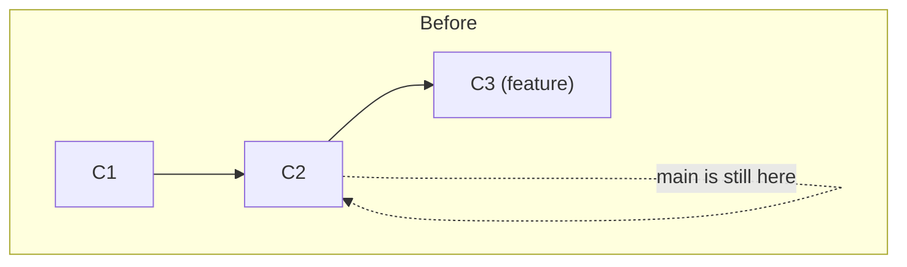
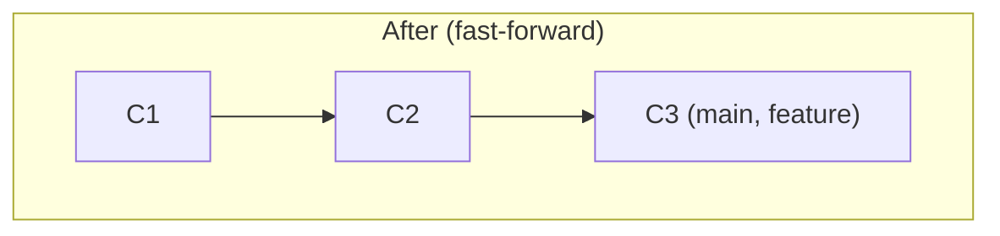
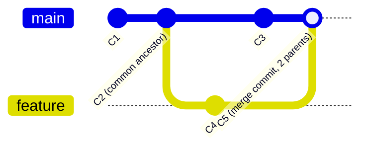

# Chapter 5 — Merging Explained

Merging is how two branches — two divergent lines of history — become one again. There are exactly two kinds of merge Git will ever perform, and Git decides which one automatically based on the shape of your history. Knowing both shapes cold is what lets you predict, before you even run the command, what your history will look like afterward.

## 5.1 Fast-forward merge

This happens when the branch you're merging **in** is a direct descendant of the branch you're merging **into** — in other words, `main` hasn't moved *at all* since `feature` branched off it. There's no actual divergence to reconcile.


```bash
git switch main
git merge feature
```


Git doesn't create any new commit here — it simply **moves the `main` pointer forward** to wherever `feature` already was. That's the entire operation, hence "fast-forward": Git is just fast-forwarding the pointer through commits that already exist. History stays perfectly linear.

## 5.2 Three-way merge (a "true" merge)

This happens when **both** branches have new commits since they diverged — `main` moved on its own, and so did `feature`. Now there's genuine divergent work on both sides that needs reconciling.



Git finds the **common ancestor** (here, `C2` — also called the "merge base," found automatically) and compares three snapshots: the common ancestor, `main`'s tip (`C3`), and `feature`'s tip (`C4`). It combines the changes from both sides relative to that shared ancestor, and — if nothing overlaps in a contradictory way — produces one new **merge commit** (`C5`) with **two parents**, pointing at both `C3` and `C4`.

```bash
git switch main
git merge feature
```
```
Merge made by the 'ort' strategy.
 login.js | 12 ++++++++++--
 1 file changed, 10 insertions(+), 2 deletions(-)
```

If a line in `login.js` was touched by *both* sides in an overlapping way, Git can't auto-combine it — that's a **merge conflict**, covered completely in [Chapter 6](06-merge-conflicts-mastery.md). Most merges do **not** conflict; Git's three-way diff algorithm handles the overwhelming majority of real-world changes automatically.

## 5.3 Merge commits carry real information — don't fear them

A merge commit isn't clutter — it's an honest historical record that two lines of work happened in parallel and were reconciled at a specific point. `git log --graph` renders this as a visible fork-and-join shape, which is often exactly the story you want your history to tell (e.g., "here is precisely when the login feature was integrated into main").

## 5.4 Controlling merge behavior explicitly

```bash
git merge feature --ff-only   # Refuse the merge unless it can fast-forward (no merge commit ever created)
git merge feature --no-ff     # ALWAYS create a merge commit, even if a fast-forward was possible
git merge feature             # Default: fast-forward when possible, real merge commit otherwise
```

`--no-ff` is a common team policy for merging *feature branches* into `main`, specifically because it preserves a visible marker of "this is where feature X was integrated" — useful for finding and reverting an entire feature as one unit later (`git revert -m 1 <merge-commit>`). Squash merges (next section) are the more common alternative on GitHub-centric teams.

## 5.5 Squash merge — a third option, technically not a "merge" at all

```bash
git merge --squash feature
git commit -m "Add complete login feature"
```

This takes **all** the changes across every commit on `feature`, and stages them as if they were one giant diff against `main` — but does **not** create a merge commit, and does **not** record any parent relationship to `feature`'s commits. You then commit that as a single, brand-new, ordinary commit on `main`. The messy history of `feature` (its 14 "wip", "fix typo", "actually fix typo" commits) disappears from `main`'s history entirely — while still existing on the `feature` branch itself, until you delete it.

This is *extremely* common on GitHub via the **"Squash and merge"** button on pull requests (Chapter 10) — it's the reason many professional repositories have a beautifully linear, one-commit-per-feature `main` branch despite contributors committing messily on their own branches.

| Approach | History shape on `main` | Preserves individual commits? | Common use |
|---|---|---|---|
| Fast-forward | Linear, no extra commit | Yes, exactly as authored | Small, solo, no divergence |
| Three-way merge (`--no-ff`) | Fork-and-join, visible merge commit | Yes | Preserving full feature-branch narrative |
| Squash merge | Linear, one new commit | No — flattened into one | Clean `main` history, messy feature branches |

## 5.6 Merge strategies (the algorithm working behind the scenes)

You'll almost never need to choose these manually, but knowing they exist is a genuine hero-level detail:

- **`ort`** ("Ostensibly Recursive's Twin") — the current default since Git 2.34, faster and more correct than its predecessor for typical two-branch merges.
- **`recursive`** — the older default; still available via `-s recursive`.
- **`octopus`** — used automatically when merging **more than two** branches at once (`git merge branchA branchB branchC`); fails immediately on any conflict rather than asking you to resolve one, since reconciling 3+ way conflicts isn't well-defined.
- **`ours` / `theirs`** (strategy, not to be confused with the conflict-resolution checkout flags in Chapter 6) — records a merge commit but discards the other side's changes entirely; a rare, deliberate "I'm merging for the historical record only" move.

```bash
git merge -X ours feature     # on a REAL conflict, auto-prefer our side's version, line by line
git merge -X theirs feature   # ...or their side's version
```
(Note the lowercase `-X ours`/`-X theirs` are conflict-resolution *options* within a normal merge — different from the standalone `-s ours` strategy which discards the other branch's content entirely, merge commit and all.)

## 5.7 Aborting a merge

If a merge conflict is more than you want to deal with right now:
```bash
git merge --abort
```
This completely resets you back to exactly how things were **before** you ran `git merge` — as if you'd never attempted it. Completely safe, always available as long as you haven't already run `git commit` to finalize the merge.

## 5.8 Quick reference

```bash
git merge <branch>              # merge <branch> INTO your current branch
git merge --no-ff <branch>      # force a merge commit
git merge --squash <branch>     # flatten into a single new commit (then `git commit`)
git merge --abort               # bail out of a conflicted/in-progress merge
git merge --continue            # after resolving conflicts and `git add`-ing them
```

> [!TIP]
> Direction matters and is a common beginner mistake: `git merge feature` while standing on `main` merges `feature` **into** `main`. Always check `git branch` (or your prompt) to confirm which branch you're currently on *before* merging — merging in the wrong direction is easy to undo (Chapter 11) but easy to avoid entirely with one habit: run `git status` first.

Next: the chapter you've been waiting for — [Chapter 6 — Merge Conflicts Mastery](06-merge-conflicts-mastery.md).
