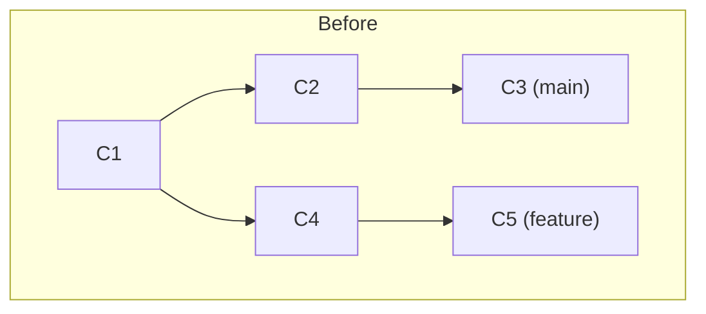
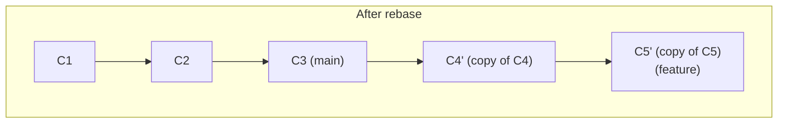

# Chapter 7 — Rebase Mastery

Merging (Chapter 5) combines two branches by creating a new commit with two parents. **Rebasing takes a completely different approach: it rewrites history by replaying your commits, one by one, onto a new starting point** — as if you'd written them there in the first place. This chapter covers what that means, why it's powerful, and the one rule that keeps it from becoming dangerous.

## 7.1 What rebase actually does, mechanically


```bash
git switch feature
git rebase main
```


Git finds the common ancestor (`C1`), temporarily "removes" your commits (`C4`, `C5`), moves your branch pointer to the new base (`C3`), then **re-applies each of your commits one at a time** as brand-new commits (`C4'`, `C5'`) on top. Crucially: **`C4'` and `C5'` are entirely new commit objects with new SHAs**, even though their content is usually identical to the originals — because a commit's hash depends on its parent, and its parent just changed. The old `C4`/`C5` still technically exist for a while (recoverable via reflog) but nothing points to them anymore once the rebase finishes.

The end result is a perfectly **linear** history — it looks exactly as if you'd written your two commits *after* `main` already had commit `C3`, even though in real time it happened the other way around.

## 7.2 Merge vs. rebase: the actual tradeoff, not a religious war

| | Merge | Rebase |
|---|---|---|
| History shape | Preserves true chronological, branching shape | Rewrites into a clean straight line |
| Creates new commits? | One new merge commit; originals untouched | Yes — **every** rebased commit gets a new SHA |
| Safe on shared/public branches? | Always | **Only if nobody else has based work on the commits you're rewriting** (Section 7.3) |
| Conflict resolution | Once, for the whole merge | Potentially once **per commit** being replayed |
| Best for | Integrating a finished feature into `main`; shared branches | Cleaning up your **own, not-yet-shared** branch before opening a PR; keeping a feature branch current with `main` |

Neither is "more correct" — they're different tools for different moments. A very common professional pattern uses **both**: rebase your feature branch onto `main` privately, as often as you like, to stay current and resolve small conflicts incrementally — then let the final integration into `main` happen via a merge (often a squash-merge through a PR, Chapter 10).

## 7.3 The Golden Rule of Rebasing

> **Never rebase commits that other people have already pulled/based work on.**

Here's precisely why this rule exists, with the disaster spelled out: say you push `feature` to GitHub, and a teammate pulls it and starts their own work on top of your commits. If you then rebase `feature` (rewriting your commits into new SHAs) and force-push, your teammate's local repository still has the *old* commits as ancestors of their new work. Their history and the remote's history no longer share a common ancestor in the way Git expects — their next `pull` will try to merge two versions of "the same" commits that now have completely different hashes, producing a tangled, duplicated mess (every commit appears twice, once under its old SHA, once under the new one) or outright conflicts on content that was never actually in conflict.

**The rule in practice:**
- Rebase freely on branches **only you** are working on.
- Never rebase `main`, `develop`, or any shared/protected branch.
- If you must rewrite a branch others have already pulled, communicate explicitly first — see [Chapter 15](15-rewriting-history-safely.md) for how to do it as safely as possible.

## 7.4 Basic rebase workflow

```bash
git switch feature
git fetch origin
git rebase origin/main       # replay your commits on top of the latest main
```

If a conflict occurs mid-replay (very possible — you're re-applying commits onto content that may have changed):
```
CONFLICT (content): Merge conflict in app.js
error: could not apply 7b2e4d1... Add validation
```
Resolve exactly like a merge conflict (Chapter 6 — same markers, same process), then:
```bash
git add app.js
git rebase --continue     # NOT `git commit` — rebase manages committing internally
```
Or bail out completely, restoring everything to before you started:
```bash
git rebase --abort
```
Or discard just the current commit being replayed and move to the next:
```bash
git rebase --skip
```

## 7.5 Interactive rebase — the real power tool

```bash
git rebase -i HEAD~4        # interactively review/rewrite the last 4 commits
```
This opens your editor with a script like:
```
pick 7b2e4d1 Add login form
pick 3c5f6a8 fix typo
pick 9a1f3c2 WIP debugging
pick 1a2b3c4 Add password reset

# Rebase abc1234..1a2b3c4 onto abc1234
#
# Commands:
# p, pick   = use commit as-is
# r, reword = use commit, but edit the commit message
# e, edit   = use commit, but stop for amending
# s, squash = combine with the commit BEFORE it, and edit the merged message
# f, fixup  = like squash, but DISCARD this commit's message entirely
# d, drop   = remove commit entirely
# x, exec   = run a shell command at this point
```
This isn't a list of commits Git will run for you unattended — **it's a script you edit**, top to bottom, and Git executes it exactly as written, in order.

### Cleaning up messy WIP commits before opening a PR (the single most common real use)

Turn this:
```
pick 7b2e4d1 Add login form
pick 3c5f6a8 fix typo
pick 9a1f3c2 WIP debugging
pick 1a2b3c4 Add password reset
```
into this:
```
pick 7b2e4d1 Add login form
fixup 3c5f6a8 fix typo
drop 9a1f3c2 WIP debugging
pick 1a2b3c4 Add password reset
```
Save and close. Git combines the typo fix silently into the login-form commit (no separate message clutter), throws away the debugging commit entirely, and leaves you with two clean, meaningful commits instead of four messy ones — with no change whatsoever to the actual final code. This is exactly how experienced engineers produce those tidy, professional-looking commit histories you see on well-run open-source projects — it's not that they never make mistakes while coding, it's that they clean up before anyone else sees it.

### Reordering commits

Just reorder the lines — Git replays them top to bottom, so whatever order they're listed in the editor is the order they'll end up in.

### Splitting one commit into two

Mark it `edit` instead of `pick`. Git stops right after re-applying that commit and hands control back to you:
```bash
git reset HEAD~1        # un-commit it, but keep all its changes staged... actually unstaged; see below
git add -p              # stage just PART of the changes
git commit -m "First half"
git add .
git commit -m "Second half"
git rebase --continue
```

### Editing an old commit's content

Also `edit`, then:
```bash
# ...make your code changes...
git add .
git commit --amend
git rebase --continue
```

### `exec` — running tests after every single replayed commit

```
pick 7b2e4d1 Add login form
exec npm test
pick 3c5f6a8 Add password reset
exec npm test
```
Or more simply: `git rebase -i --exec "npm test" HEAD~4` inserts that after every commit automatically. Genuinely useful for confirming that **every commit in your branch, individually**, leaves the codebase in a working state — not just the final one. This matters a lot if your team ever uses `git bisect` (Chapter 12), since bisect assumes every commit is independently buildable/testable.

## 7.6 Autosquash — letting Git write the interactive script for you

Instead of manually finding and marking a fixup in the editor, tell Git upfront which earlier commit a new tiny fix belongs to:
```bash
git commit --fixup=3c5f6a8
# later...
git rebase -i --autosquash main
```
Git automatically reorders the todo list so your fixup commit is already positioned right after `3c5f6a8` and pre-marked `fixup` — you just save and close, no manual reordering required. (Set `git config --global rebase.autosquash true` to make `--autosquash` the permanent default whenever you run an interactive rebase.)

## 7.7 `git rebase --onto` — the advanced move

The plain `git rebase main` replays "everything since the common ancestor with main." Sometimes you need finer control — say, moving just *part* of a branch onto a totally different base. `--onto` takes three arguments: **new base**, **old base (exclusive)**, **branch to move**:

```bash
git rebase --onto main feature-old-base feature
```
Reads as: *"Take everything on `feature` that came after `feature-old-base`, and replay it directly onto `main`, ignoring whatever else was on the old base."* Classic real use case: you branched a second feature off an unfinished first feature branch, but the first feature got scrapped — `--onto` lets you surgically re-parent your second feature's commits directly onto `main`, skipping the abandoned work entirely, without manually cherry-picking each commit.

## 7.8 Quick reference

```bash
git rebase main                    # replay current branch onto latest main
git rebase -i HEAD~N                # interactively edit the last N commits
git rebase --continue                # after resolving a conflict
git rebase --abort                   # bail out completely, back to pre-rebase state
git rebase --skip                    # discard the current commit, move to next
git rebase --onto NEW OLD BRANCH     # surgical re-parenting
git commit --fixup=<sha>             # mark a commit for autosquash later
git rebase -i --autosquash main      # apply all pending fixups automatically
```

You now understand both major ways Git reconciles divergent history, and precisely when each is (and isn't) safe. Next: [Chapter 8 — Remotes & Collaboration](08-remotes-and-collaboration.md), where branches stop being a solo activity.
