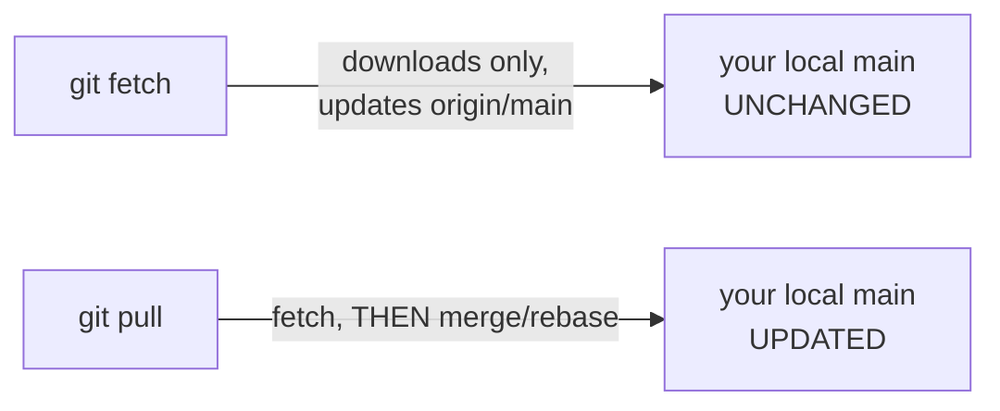
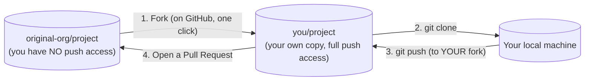

# Chapter 8 — Remotes & Collaboration

Everything so far has worked entirely on your own machine. This chapter connects your local repository to others — the part of Git that actually makes teamwork possible.

## 8.1 What a "remote" is

A remote is just a **named URL** pointing to another copy of the repository — almost always hosted on a service like GitHub. When you clone a repo, Git automatically creates a remote named `origin` pointing at wherever you cloned it from. "Origin" is just a convention (like calling your first branch `main`), not a magic word — you could rename it, and you'll meet a second, differently-named remote in Section 8.5 (forks).

```bash
git remote -v
# origin  git@github.com:you/project.git (fetch)
# origin  git@github.com:you/project.git (push)

git remote add upstream git@github.com:original-org/project.git
git remote rename origin old-origin
git remote remove old-origin
```

## 8.2 `fetch` vs. `pull` — the distinction almost everyone glosses over

This is one of the most commonly misunderstood pairs of commands in all of Git.

```bash
git fetch origin
```
`fetch` downloads any new commits, branches, and tags from the remote — and updates your local **remote-tracking branches** (`origin/main`, etc., from Chapter 4) to match. **It never touches your working directory or your local branches.** It's purely "go find out what's new," completely safe to run at any time, as often as you like.

```bash
git pull origin main
```
`pull` is explicitly defined as **`git fetch` immediately followed by either a merge or a rebase** of your current local branch against the newly-fetched remote-tracking branch. This second step **does** touch your working directory and can create a merge commit or replay your commits, depending on configuration.



**Practical habit worth adopting:** run `git fetch` + `git log --oneline main..origin/main` to *preview* exactly what's new before deciding how to integrate it, rather than blindly `pull`-ing and hoping. Especially valuable before touching a branch with history you don't fully trust yet.

### Configuring which strategy `pull` uses

```bash
git config --global pull.rebase false   # merge (creates a merge commit) — Git's traditional default
git config --global pull.rebase true    # rebase (replays your local commits on top) — cleaner, linear history
git config --global pull.ff only        # refuse to pull unless a fast-forward is possible; otherwise error out
```
Many experienced teams set `pull.rebase true` globally, specifically because it avoids a steady trickle of trivial "Merge branch 'main' into main" commits cluttering history from routine pulls. Either is fine as a personal default; what matters is that your **whole team agrees**, since it changes what your history looks like after every sync.

## 8.3 `push` — sending your commits to the remote

```bash
git push origin main                   # push local `main` to remote `main`
git push -u origin feature/login       # push AND remember this pairing (-u = --set-upstream)
git push                               # after -u has been set once, just this works
```

`-u`/`--set-upstream` links your local branch to a specific remote branch so that afterward, plain `git push` and `git pull` (no arguments) know exactly where to send/receive without you specifying every time. `git branch -vv` shows you all these local-to-remote pairings at a glance.

### The rejected push

```bash
$ git push
 ! [rejected]        main -> main (non-fast-forward)
error: failed to push some refs
hint: Updates were rejected because the tip of your current branch is behind
hint: its remote counterpart.
```
This means **someone else pushed to this branch since you last synced** — Git is protecting you from silently overwriting their commits. The fix is almost always:
```bash
git pull       # integrate their changes into yours first (merge or rebase, per your config)
# resolve any conflicts, exactly as in Chapter 6/7
git push       # now it's a fast-forward from the remote's perspective, and succeeds
```
**Never** reach for `git push --force` here as a first instinct — that's precisely the footgun covered in [Chapter 15](15-rewriting-history-safely.md#154-force-push-safety---force-vs---force-with-lease-vs---force-if-includes). Force-pushing over a rejection means erasing whatever your teammate just pushed.

## 8.4 Tracking branches, made concrete

```bash
$ git branch -vv
* main              a1b2c3d [origin/main] Update README
  feature/login      7b2e4d1 [origin/feature/login: ahead 2] Add password reset
```
`[origin/main]` shows what each local branch is tracking, and `ahead 2` / `behind 3` tells you exactly how far your local branch has diverged from its remote-tracking counterpart — computed by comparing the two pointers directly, no network call needed (it's comparing against your **locally cached** remote-tracking branch, which is why running `git fetch` first matters if you want an up-to-date comparison).

## 8.5 The fork workflow

On GitHub, you often don't have push access to a repository you want to contribute to (any open-source project, for instance). The standard pattern:



```bash
# 1. Fork on github.com (button, top-right of the repo page) — creates you/project
# 2. Clone YOUR fork, not the original
git clone git@github.com:you/project.git
cd project

# 3. Add the ORIGINAL repo as a second remote, conventionally named "upstream"
git remote add upstream git@github.com:original-org/project.git

git remote -v
# origin    git@github.com:you/project.git (fetch/push)   <- your fork, push here
# upstream  git@github.com:original-org/project.git (fetch/push)  <- original, usually fetch-only for you
```

### Keeping your fork in sync with upstream

Your fork doesn't automatically stay current when the original project moves forward — you have to explicitly pull those changes in:

```bash
git fetch upstream
git switch main
git merge upstream/main      # or: git rebase upstream/main
git push origin main         # update YOUR fork on GitHub too
```

You now understand exactly how code travels between machines and between people in Git — the missing piece that turns "a tool on my laptop" into "a way for a whole team, or the whole internet, to build software together." Next: [Chapter 9 — GitHub Platform Essentials](09-github-platform-essentials.md), where we shift focus from Git-the-tool to GitHub-the-platform.
