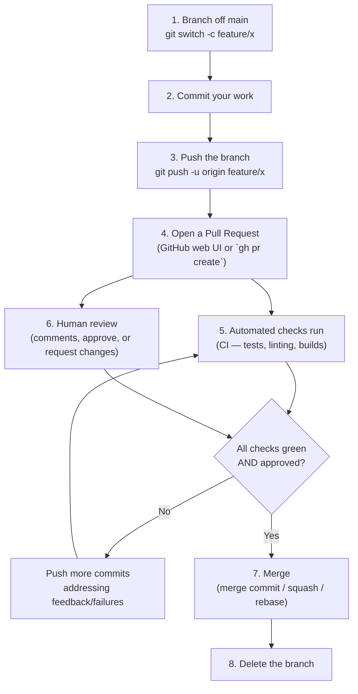

# Chapter 10 — Pull Requests & Code Review

If Chapters 1–8 taught you Git, and Chapter 9 taught you the GitHub product around it, this chapter teaches you the thing those two combine to produce: **the actual daily workflow used by essentially every professional software team on Earth.** Master this loop and you can walk into any company and be productive on day one.

## 10.1 What a Pull Request actually is

A Pull Request (PR) is **not a Git concept** — Git has no idea what a PR is. It's a GitHub feature built entirely on top of ordinary branches: a PR is a request to merge one branch (the "compare"/"head" branch) into another (the "base" branch), bundled with a running conversation thread, a diff view, comment threads on specific lines, approval/rejection states, and automated check results (Chapter 17). Under the hood, a PR is still just two branches and a diff — everything else is UI and metadata GitHub layers on top.

## 10.2 The full lifecycle



```bash
git switch -c feature/dark-mode
# ... make commits ...
git push -u origin feature/dark-mode
gh pr create --title "Add dark mode toggle" --body "Closes #58"
```
The web UI asks the same three things `gh pr create` does: a **base branch** (usually `main`), a **compare branch** (your feature branch), a **title**, and a **description** — the description is where `Closes #58`-style keywords (Chapter 9.3) go.

## 10.3 Draft Pull Requests

Mark a PR as **Draft** when you want early visibility or feedback but the work isn't ready for a real review or to be merged — CI still runs, teammates can still comment, but reviewers know not to do a full pass yet, and the merge button stays disabled until you click "Ready for review." This is the professional alternative to opening a PR "for real" too early, or (worse) not opening one until everything is perfect and missing the chance for early course-correction.

```bash
gh pr create --draft
```

## 10.4 The review process

- **Requesting reviewers** — explicitly tag specific people, or let **CODEOWNERS** (a `.github/CODEOWNERS` file mapping file paths to usernames/teams) auto-request the right people based on which files changed.
- **Review states a reviewer can leave:**
  | State | Meaning |
  |---|---|
  | **Comment** | General feedback, no verdict either way |
  | **Approve** | "This is good to merge as-is" |
  | **Request changes** | "Do not merge until these specific issues are addressed" — can block merging if branch protection requires it (10.6) |
- **Inline comments** — click any line in the diff to comment on that exact line; threads stay attached to that line (and follow it across new pushes, when possible).
- **Suggested changes** — a reviewer can propose an exact replacement for a few lines; the author applies it with a single click, which creates a real commit authored... actually committed by the PR author's branch, containing exactly that suggested text — genuinely faster than "please change X to Y" prose for small fixes.

## 10.5 The three merge methods — know these cold

This is one of the most consequential everyday decisions on a GitHub-centric team, and the dropdown next to the merge button offers exactly three choices:

| Method | What happens to history | When to use |
|---|---|---|
| **Create a merge commit** | Every commit from the feature branch is preserved, plus one new merge commit tying them together (Chapter 5.2–5.3) | You want full, honest history of exactly how and when work happened — common on `main` branches that value traceability |
| **Squash and merge** | All commits on the branch are flattened into **one single new commit** on the base branch (Chapter 5.5) | You want a clean, linear, one-commit-per-feature `main` — by far the most popular default on modern teams, since it doesn't punish contributors for messy WIP commits |
| **Rebase and merge** | Every commit is individually replayed onto the base branch, preserving each one but with **new SHAs** and no merge commit at all (Chapter 7.1) | You want full commit-level granularity preserved AND a linear history, and you trust every individual commit in the branch to be clean and meaningful on its own |

Repository admins can restrict which of these three options are even available, under **Settings → General → Pull Requests** — many teams disable everything except "Squash and merge" specifically to enforce a consistently clean `main`.

## 10.6 Branch protection rules

**Settings → Branches → Branch protection rules**, applied to `main` (or any branch pattern) on repos where you're an admin:

- **Require a pull request before merging** — nobody, including admins (optionally), can push directly to `main`.
- **Require approvals** — e.g., at least 1 or 2 reviewers must approve.
- **Require status checks to pass** — CI (Chapter 17) must be green before the merge button even becomes clickable.
- **Require branches to be up to date before merging** — forces you to sync the latest `main` into your branch first (Section 10.7), guaranteeing your CI run reflects reality.
- **Require linear history** — disallows merge commits entirely (forces squash or rebase merges only).
- **Require signed commits** — see [Chapter 14](14-advanced-git-toolkit.md#144-signing-commits).
- **Do not allow force pushes / do not allow deletions** — protects the branch from history-rewriting entirely, from anyone.

These rules are how a team's *process* (code review, CI, no direct pushes) becomes technically *enforced* rather than just a policy people are trusted to follow.

## 10.7 Resolving conflicts on a PR

If `main` has moved forward since you branched, and those changes overlap with yours, GitHub shows **"This branch has conflicts that must be resolved."** Two ways to fix it, same underlying Git operations from Chapters 6–7:

```bash
# Option A: merge main into your feature branch
git switch feature/dark-mode
git fetch origin
git merge origin/main
# resolve conflicts exactly as in Chapter 6, then:
git push

# Option B: rebase your branch onto the latest main (cleaner history, if you're the only one on this branch)
git fetch origin
git rebase origin/main
# resolve conflicts exactly as in Chapter 7, then:
git push --force-with-lease   # REQUIRED after a rebase — see Chapter 15 for why this exact flag
```
GitHub's web UI also offers an **"Update branch"** button for simple cases, which performs option A (a merge) on GitHub's servers without you touching your local machine at all.

## 10.8 PR etiquette that actually matters

- **Keep PRs small.** A 50-line PR gets reviewed carefully in 10 minutes. A 2,000-line PR gets rubber-stamped because nobody has time to truly read it — defeating the entire purpose of review.
- **Write a real description.** What changed, why, and how you tested it. "Fixes bug" helps nobody six months from now.
- **Respond to every comment**, even just with an emoji reaction or "Done" — an unanswered comment thread looks like you ignored the reviewer.
- **As a reviewer:** be specific, suggest rather than demand where reasonable, and separate "this is objectively broken" from "this is a style preference" explicitly in your wording.
- **Don't take "Request changes" personally** — it's a statement about the code, and its entire purpose is to catch things before they reach production, which is a favor to everyone including future-you.

## 10.9 Stacked PRs (advanced, worth knowing exists)

When a change is too large for one clean PR but its pieces genuinely depend on each other in sequence, experienced teams **stack** PRs: PR #2's base branch is PR #1's feature branch (not `main`), and so on. Each PR stays small and independently reviewable, merging in order (#1, then #2 gets automatically re-based onto `main`, etc.). Tools like GitHub's own stacking support, or third-party tools (Graphite, `gh` extensions), manage the rebasing-cascade this creates automatically — worth knowing the concept exists even if you don't need it on day one.

You now know the complete professional loop — branch, PR, review, merge — used at essentially every software company. Next: [Chapter 11 — Undoing Changes & Time Travel](11-undoing-changes-time-travel.md), the chapter that removes all fear of making a mistake.
