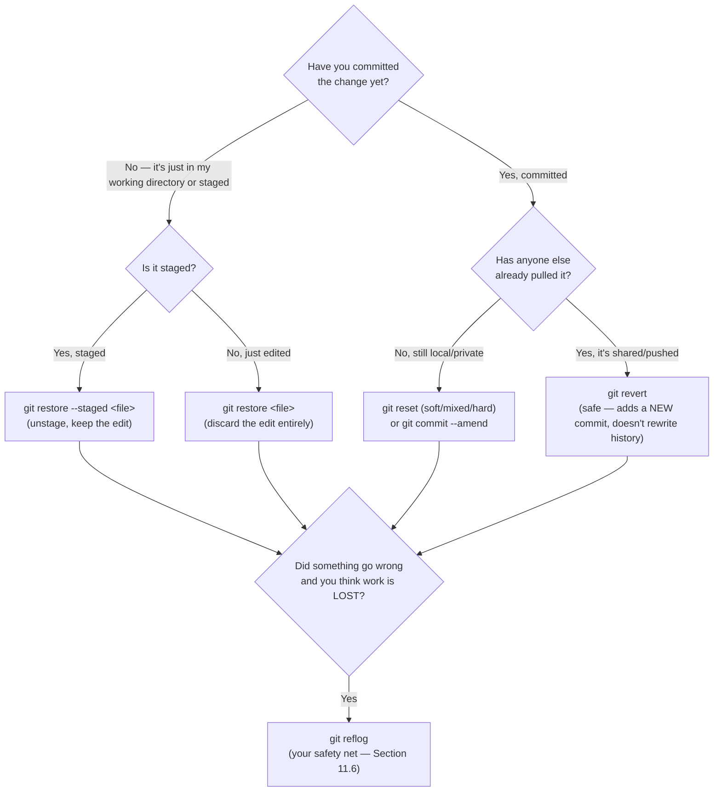
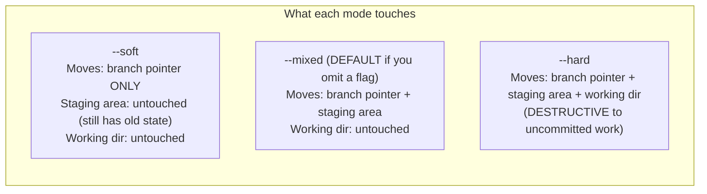

# Chapter 11 — Undoing Changes & Time Travel

This chapter is, arguably, the one that most permanently separates confident Git users from nervous ones. Once you genuinely understand `restore`, `reset`, `revert`, and — above all — `reflog`, you'll realize there is almost no mistake in Git you can't walk back from. That confidence changes how boldly you're willing to experiment, which makes you faster at everything else.

## 11.1 The decision tree: which command do I actually want?



Keep this diagram in your head — nearly every "how do I undo X" question in Git reduces to one branch of this tree.

## 11.2 `git restore` — the modern, focused tool for working-directory and staging undo

Introduced in Git 2.23 specifically to take over the confusing parts of old-style `git checkout` (Chapter 4.2):

```bash
git restore file.js              # discard uncommitted changes in the WORKING DIRECTORY, back to last commit
git restore --staged file.js     # unstage a file (move it OUT of staging, but keep your edits in the working dir)
git restore --staged --worktree file.js   # do both at once — fully reset this file to the last commit, staged AND working dir
git restore --source=HEAD~3 file.js       # restore a file's content from 3 commits ago, into your working directory
```

> [!CAUTION]
> `git restore <file>` **permanently discards uncommitted edits to that file with no confirmation.** There is no undo for this specific action other than your editor's local undo history (if it's still open) — this is the one truly destructive command in this section that doesn't touch the commit graph at all, so `reflog` (11.6) cannot help you here, since reflog only tracks *commits*, and a discarded uncommitted edit was never a commit. Double-check `git diff` before running it.

## 11.3 `git reset` — rewinding your branch pointer, with three levels of force

`reset` moves your current branch's pointer to a different commit — and, depending on the mode, also adjusts the staging area and/or working directory to match. This is the command with the most "wait, what did that actually do?" confusion in all of Git, so here's the exact breakdown:



```bash
git reset --soft HEAD~1     # "Un-commit" the last commit, but keep everything staged, ready to re-commit differently
git reset HEAD~1            # (--mixed, the default) Un-commit AND un-stage — changes land back as plain edits in your working dir
git reset --hard HEAD~1     # Un-commit, un-stage, AND wipe the actual file changes — as if that commit's work never happened
```

**Concrete example — combining your last 3 commits into 1:**
```bash
git reset --soft HEAD~3
git commit -m "One clean commit replacing the previous three"
```
This works because `--soft` only rewound the branch pointer; all three commits' combined changes are still sitting in the staging area, ready to be re-committed as a single new commit.

> [!WARNING]
> `git reset --hard` **permanently discards any uncommitted work** in the files it touches, with no prompt. It's one of the two or three most dangerous everyday Git commands. Always run `git status` immediately before it, and consider `git stash` (Chapter 12) first if there's anything in your working directory you're not 100% sure you want gone.

### `reset` also works on individual files (this is the "unstage" mechanism)

```bash
git reset HEAD file.js      # unstage a single file (old-style syntax; `git restore --staged file.js` is the modern equivalent)
```

## 11.4 `git revert` — the safe way to undo shared/pushed commits

`reset` rewrites history — it makes it look like the undone commit never happened. That's fine on a private branch, but **catastrophic on a shared branch** others have already pulled (exactly the Golden Rule from Chapter 7.3 — rewriting history out from under people who've built on it). `revert` solves this by **adding a brand-new commit that applies the exact opposite change**, leaving the original commit fully intact in history:

```bash
git revert a1b2c3d
```
```
[main 9f8e7d6] Revert "Add experimental payment flow"
```
History now honestly shows: this was added, and later, deliberately, undone. Nothing was erased or rewritten — which is exactly why `revert` is safe to use on `main`, on a released branch, on anything anyone else might already have.

```bash
git revert HEAD~3..HEAD          # revert a whole range of commits (oldest to newest, applied in reverse order)
git revert -n a1b2c3d            # stage the revert but don't auto-commit yet (lets you combine several reverts into one commit)
git revert -m 1 <merge-commit-sha>   # revert an entire MERGE commit — you must specify which parent (-m 1 or -m 2) is "mainline"
```
That last one deserves a moment: reverting a merge commit is genuinely one of Git's sharper edges. `-m 1` almost always means "treat the branch I merged *into* as mainline, undo everything that came in from the other side" — which is what you want 95% of the time (e.g., undoing an entire feature that was merged into `main` via a merge commit).

## 11.5 `git commit --amend` — fixing the commit you *just* made

```bash
git commit --amend -m "Corrected commit message"
# — or, to also include additional staged changes you forgot: —
git add forgotten-file.js
git commit --amend --no-edit    # keep the same message, just fold in the new changes
```
Amending doesn't edit the old commit in place — Git can't do that, since a commit's hash is derived from its content (Chapter 1.7). It creates a **brand-new commit** with a new SHA, and moves your branch pointer to it; the old commit becomes unreachable (but recoverable via reflog, as always, for a while).

> [!CAUTION]
> Only amend commits that are still **local and unpushed** — amending a commit that's already on a shared remote is exactly the same category of problem as rebasing shared history (Chapter 7.3), because it changes that commit's SHA.

## 11.6 `git reflog` — your ultimate safety net

This is, without exaggeration, the single most valuable "I panicked and thought I lost everything" command in Git, and a genuinely large fraction of experienced developers have never used it. Here's the concept: **Git keeps a private, local log of every single place `HEAD` has pointed to, for the last several months, by default — completely separate from the commit graph itself.** Every commit, checkout, reset, rebase, and merge leaves an entry.

```bash
$ git reflog
9f8e7d6 (HEAD -> main) HEAD@{0}: reset: moving to HEAD~1
a1b2c3d HEAD@{1}: commit: Add experimental payment flow
7b2e4d1 HEAD@{2}: checkout: moving from feature/x to main
3c5f6a8 HEAD@{3}: commit: WIP payment refactor
```
Read this as a timeline, most recent action at the top. Notice `HEAD@{1}` — that's the commit `Add experimental payment flow`, which a `git reset --hard HEAD~1` (the entry at `HEAD@{0}`) just made unreachable from any branch. **It is not gone.** The commit object itself is still sitting in Git's object database untouched; only the pointer to it moved. Recovering it is one command:

```bash
git reset --hard HEAD@{1}
# — or, more surgically, without touching your current branch: —
git switch -c rescued-branch HEAD@{1}
```

**This works for recovering:**
- Work wiped by an accidental `git reset --hard`
- Commits stranded by a detached-HEAD mistake (Chapter 4.7)
- An entire branch you deleted with `git branch -D` (find its last commit in the reflog, then `git switch -c branch-name <that-sha>`)
- Commits "lost" during a rebase gone wrong (every intermediate state during a rebase gets its own reflog entry too)

> [!TIP]
> `reflog` is **local only** — it lives in your own `.git` folder and was never pushed anywhere, and it isn't shared when someone clones your repo. It's also not permanent forever; unreachable commits are eventually garbage-collected (default: unreachable reflog entries expire after 90 days, `git gc` sweeps orphaned objects after that) — but "eventually, after 90 days" is such a wide safety margin that in practice you should treat almost any recent mistake as fully recoverable.

## 11.7 The absolute last resort: `git fsck`

On the rare occasion something is gone even from reflog (a fresh clone has no reflog history for commits it never checked out locally, for instance), you can still search the raw object database for orphaned commits:

```bash
git fsck --full --no-reflogs --unreachable --lost-found
```
This lists unreachable commit SHAs directly from the object store — you can inspect any of them with `git show <sha>` and, if it's what you're looking for, resurrect it with `git switch -c recovered <sha>`, exactly as with a reflog entry.

## 11.8 Quick reference

```bash
git restore <file>                  # discard uncommitted changes to a file
git restore --staged <file>         # unstage a file
git reset --soft HEAD~1             # un-commit, keep staged
git reset HEAD~1                    # un-commit, unstage (default mode)
git reset --hard HEAD~1             # un-commit AND discard the actual changes (destructive)
git revert <sha>                    # safely undo a commit by adding a new, opposite commit
git commit --amend                  # fix your most recent commit
git reflog                          # see everywhere HEAD has been — your time machine
git switch -c saved HEAD@{2}        # resurrect anything reflog remembers
```

You now have, functionally, a permanent undo button for almost anything in Git. Next: [Chapter 12 — Stash, Cherry-pick & Bisect](12-stash-cherrypick-bisect.md).
