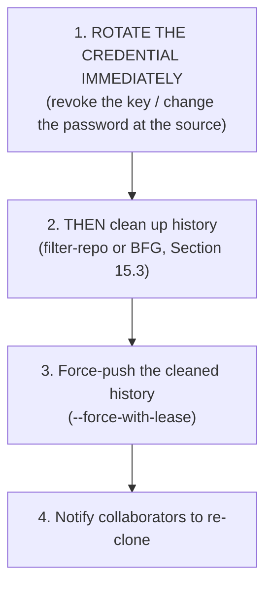

# Chapter 15 — Rewriting History Safely

Everything in this chapter rewrites commit SHAs — meaning everything here collides with the Golden Rule from [Chapter 7.3](07-rebase-mastery.md#73-the-golden-rule-of-rebasing). Read that section again if you skipped it. This chapter is about doing these operations as safely as they can be done, and knowing precisely when they're worth the risk.

## 15.1 The spectrum of history-rewriting, from routine to nuclear

| Operation | Scope | Risk level |
|---|---|---|
| `git commit --amend` | Last commit only | Low — routine, as long as it's unpushed |
| `git rebase -i` | A handful of recent, private commits | Low-Medium — routine on your own branches |
| `git filter-repo` | The **entire history** of the repository | High — coordinate with your whole team first |
| `git push --force` | Overwrites a remote branch unconditionally | High — can destroy others' work with zero warning |

## 15.2 Cleaning up a branch before opening a PR

The routine, low-risk end of this spectrum — already covered in depth in [Chapter 7.5](07-rebase-mastery.md#75-interactive-rebase--the-real-power-tool): interactive rebase to squash WIP commits, reorder, reword, or drop debugging commits, entirely on a branch nobody else has touched yet. This is not just safe, it's genuinely professional practice — it's how experienced engineers produce the clean, readable histories you see in well-run projects, without ever needing to be perfect on the first try while actually writing the code.

## 15.3 Purging a file from your *entire* history

Sometimes a problem isn't in your last few commits — it's baked into history from months or years ago (a large binary file bloating every clone forever, or — far more urgently — a secret). The old tool for this, `git filter-branch`, is now officially deprecated by Git itself for being slow and dangerously easy to misuse. Use **`git filter-repo`** instead (a separate install: `pip install git-filter-repo`, or via your package manager):

```bash
git filter-repo --path secrets.env --invert-paths
```
This rewrites **every single commit** in the repository's history that ever touched `secrets.env`, producing a new history with that file (and thus its content) completely removed, everywhere it ever appeared — not just deleted going forward. Every commit after the file's first appearance gets a new SHA, since their content (and thus hash) has genuinely changed.

The alternative many teams use instead, particularly for the specific "remove secrets" case: **[BFG Repo-Cleaner](https://rtyley.github.io/bfg-repo-cleaner/)** — a purpose-built tool that's typically much faster than `filter-repo` for this exact job and has a simpler command surface:
```bash
bfg --delete-files secrets.env
bfg --replace-text banned-strings.txt   # scrub a specific secret VALUE wherever it appears, across all files/commits
```

> [!IMPORTANT]
> After either tool, **every clone anyone has of this repository is now based on the "wrong" (old) history.** You must force-push the rewritten history, and every single collaborator must **re-clone the repository from scratch**, or very carefully rebase their own local work onto the new history — there is no clean, automatic way for their old clone to reconcile with a completely rewritten past. This is exactly why the next section exists.

## 15.4 Force-push safety: `--force` vs. `--force-with-lease` vs. `--force-if-includes`

Any time you rewrite already-pushed history (an amend, a rebase, a `filter-repo` run) and need to update the remote to match, a plain `push` is rejected (Chapter 8.3 — it looks like a non-fast-forward from the server's point of view, because, well, it is one). You need to explicitly force it:

```bash
git push --force origin feature/x
```
**This is the single most dangerous everyday Git command that people run casually.** It says, unconditionally: *"Whatever is on the remote right now, overwrite it completely with what I have — I don't care what's there."* If a teammate pushed a new commit to that branch two minutes ago that you haven't even fetched yet, `--force` erases it from the remote, silently, with no warning. It will not even be in *your* reflog, because you never had it locally in the first place — it can be genuinely unrecoverable from your end (though GitHub itself retains unreferenced commits for a while server-side, recoverable via support in true emergencies).

```bash
git push --force-with-lease origin feature/x
```
**This is the version you should actually use, by default, always.** It says instead: *"Overwrite the remote — but only if it still looks exactly like what I last fetched. If someone else has pushed something I haven't seen yet, refuse and tell me, instead of clobbering it."** Under the hood, it compares the remote's current tip against your local record of `origin/feature/x` (your remote-tracking branch, Chapter 4.5) before allowing the push — if they don't match, the push is rejected, exactly like a normal non-force push would be, and you're prompted to `fetch` and look at what changed before deciding what to do next.

```bash
git push --force-if-includes origin feature/x
```
A newer refinement (Git 2.30+), used together with `--force-with-lease`: it additionally verifies that the remote's current tip is actually an ancestor of your local reflog for that branch — closing a narrow edge case where `--force-with-lease` alone could theoretically still be fooled by a very specific sequence of fetches. Increasingly recommended as the modern default pairing:
```bash
git config --global push.useForceIfIncludes true    # makes --force-with-lease imply this check automatically
```

**The rule, stated simply: never type `git push --force` from muscle memory. Type `git push --force-with-lease` instead, every time, as the default habit.** It costs nothing when you're genuinely the only one touching the branch, and it's the only thing standing between you and silently deleting a teammate's work when you're not.

## 15.5 What to actually do if you commit a secret (API key, password, token)

This deserves its own walkthrough because the *order of operations* matters more than the Git mechanics:



**Step 1 is not optional and cannot be skipped, ever, for any reason — and it must happen before step 2, not after.** The instant a secret is pushed to GitHub — even to a private repo, even for ten seconds before you delete the commit — you must assume it has been seen, cached, indexed, or scraped (GitHub itself runs automated secret-scanning that may have already flagged it; other automated scrapers exist too, entirely outside your control). **Rewriting history removes the string from your repository's future — it does absolutely nothing to un-expose a credential that already leaked.** A rotated (revoked and reissued) credential is safe regardless of who saw the old one. A credential that's merely "removed from Git history" but never rotated is still live and compromised, sitting in who-knows-how-many caches, scrapers, and forks. Rotate first, always — the history cleanup afterward is just tidiness, not the actual security fix.

## 15.6 Quick reference

```bash
git commit --amend                          # fix your last commit (safe if unpushed)
git rebase -i HEAD~N                        # clean up recent PRIVATE commits (Chapter 7)
git filter-repo --path secret.txt --invert-paths   # purge a file from ALL of history
git push --force-with-lease                 # the force-push you should actually use
git push --force-if-includes                # an even safer pairing with the above
```

> [!TIP]
> If you're ever unsure whether an operation is "safe" — ask one question: **has this commit's current SHA already been pushed anywhere someone else might have fetched it?** If no, rewrite freely. If yes, either avoid rewriting it (prefer `revert`, Chapter 11.4) or communicate explicitly with everyone who might be affected before you force-push.

Next: [Chapter 16 — Branching Strategies & Workflows](16-branching-strategies-and-workflows.md), where we zoom out from individual commands to how whole teams organize their branches.
