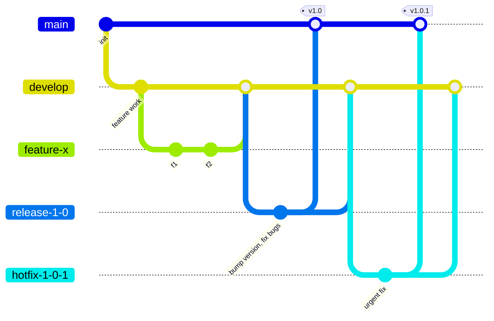
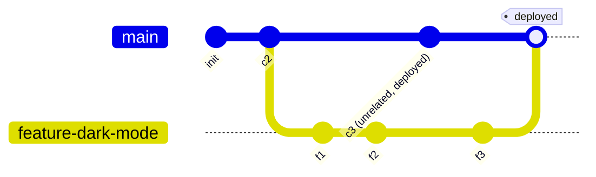

# Chapter 16 — Branching Strategies & Workflows

Everything so far has been "how do I use this specific command." This chapter is "how does a whole team agree on a *shared system* for using them together." A branching strategy is a team-wide convention — not enforced by Git itself, but often partially enforced via GitHub branch protection (Chapter 10.6) — for how branches are created, named, merged, and released.

## 16.1 Git Flow

Designed in 2010 for projects with **scheduled, versioned releases** (think: desktop software, mobile apps with app-store review cycles) rather than continuous deployment.

*(Branch names here use hyphens instead of the `feature/x` slash-style naming from [Chapter 4.4](04-branching-deep-dive.md#44-branch-naming-conventions) — purely a diagram-rendering-compatibility choice; use real slashes in your actual Git branches.)*

| Branch | Purpose | Lifetime |
|---|---|---|
| `main` | Always reflects the latest **released** production code | Permanent |
| `develop` | Integration branch where finished features accumulate between releases | Permanent |
| `feature/*` | One branch per feature, branched from `develop`, merged back into `develop` | Temporary |
| `release/*` | Freezes scope for final testing/bug-fixing/version-bumping before a release | Temporary |
| `hotfix/*` | Urgent production fixes, branched from `main`, merged into **both** `main` and `develop` | Temporary |

**Pros:** very structured, clear separation between "in progress" and "released," well-suited to multiple versions being supported in production simultaneously. **Cons:** heavyweight for small teams or products that deploy many times a day — `develop` and `main` can drift, and the ceremony around release branches slows down fast-moving teams for little benefit if you don't actually need versioned releases.

## 16.2 GitHub Flow

The simpler, far more common model for web applications and anything using **continuous deployment**. There is exactly one long-lived branch.

The rule set is almost embarrassingly simple:
1. `main` is always deployable.
2. Branch off `main` for any new work (`feature/...`, `fix/...`).
3. Open a Pull Request early, push commits regularly.
4. Once reviewed and CI passes, merge into `main`.
5. **Deploy immediately** after merging.

**Pros:** fast, low-ceremony, matches how modern CI/CD actually deploys (every merge to `main` can trigger an automatic deploy — Chapter 17). **Cons:** assumes you genuinely can deploy `main` at any moment — a poor fit for software with slow release cycles, app-store review, or multiple simultaneously-supported versions in the field.

## 16.3 Trunk-Based Development

An even more extreme version of "keep it simple": everyone commits **directly to `main` (the "trunk")**, or through extremely short-lived branches (hours, not days), merged multiple times per day. Large or risky changes are shipped *safely* not by hiding them on a long-lived branch, but via **feature flags** — the code ships to `main` and to production, but is switched off for real users until it's ready, then toggled on remotely without a deploy.

**Pros:** near-zero merge conflict risk (branches barely live long enough to diverge meaningfully), extremely fast feedback loops, forces genuinely small, incremental changes. **Cons:** requires real discipline and infrastructure (feature flag tooling, strong automated test coverage, a culture that supports very frequent small commits) — doesn't work well if your team can't yet ship confidently without long code-review cycles per change.

## 16.4 GitLab Flow / Release branches (a middle ground)

A hybrid: keep GitHub Flow's simplicity for day-to-day feature work, but add dedicated **environment branches** (`staging`, `production`) or **release branches** (`release/2.x`) downstream of `main`, which code is promoted into deliberately rather than deploying straight from every merge. Useful when you need a staged rollout process (`main` → `staging` → `production`) without the full weight of Git Flow's `develop` branch and structured release-branch ceremony.

## 16.5 Choosing one — a decision guide

| Your situation | Best fit |
|---|---|
| Web app/SaaS, deploy many times a day, one live version | **GitHub Flow** |
| Mobile app / desktop software with app-store review, or must support multiple versions in the field at once | **Git Flow** |
| Large team, mature test/CI culture, want maximum speed and minimal merge pain | **Trunk-Based Development** (with feature flags) |
| Need a distinct staged rollout (dev → staging → prod) without full Git Flow overhead | **GitLab Flow / release branches** |

None of these are enforced by Git — they're conventions your team agrees on and (partially) locks in via branch protection rules. **Most real teams end up with some pragmatic variant, not a textbook-pure version of any one of these** — and that's completely fine. What actually matters is that everyone on the team has the same shared mental model of "where do I branch from, and where does my work end up," which is exactly what a written-down strategy like this gives you.

Next: [Chapter 17 — GitHub Actions & Automation](17-github-actions-and-automation.md), where merging to a branch starts triggering things automatically.
